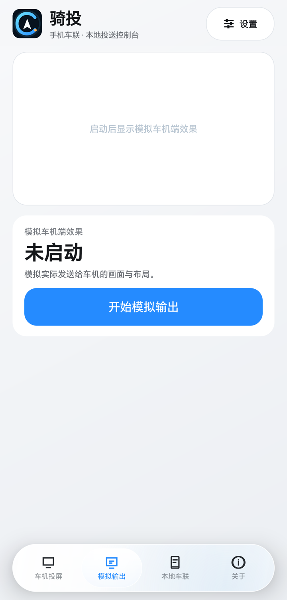
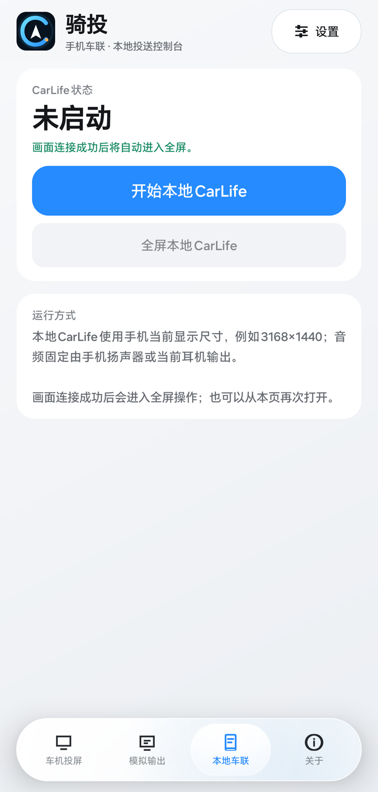
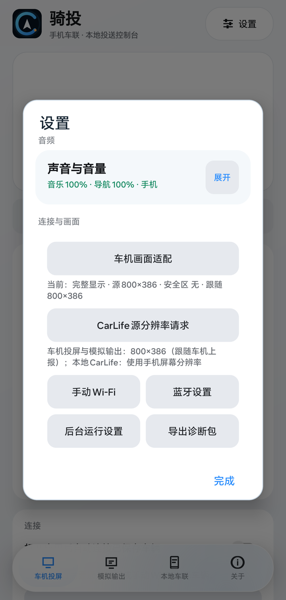
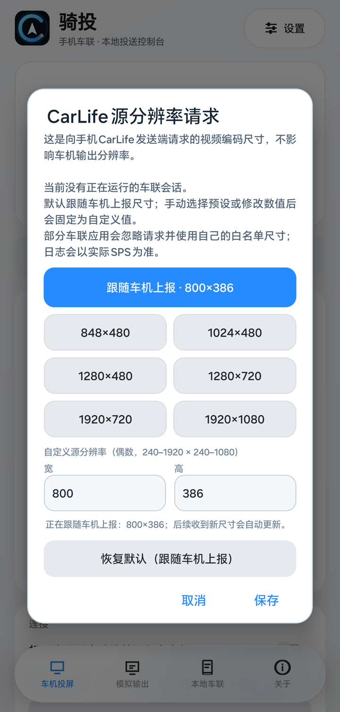

  

<h1 align="center">骑投 QITOU</h1>

把手机车联画面与声音投送到摩托车仪表

  <a href="https://github.com/yuppiesnotzhuhao/QITOU/releases/latest">下载最新版</a>
  ·
  <a href="https://github.com/yuppiesnotzhuhao/QITOU/issues">问题反馈</a>

骑投是面向 Android 手机的本地投送控制台。它接收手机 CarLife 画面，通过 MotoPlay /
PXC 发送到兼容仪表，并支持在手机内触摸操作。

当前版本：`0.18.1 (65)`。不依赖 Root、Shizuku、Android Auto、CarPlay、悬浮窗或
无障碍服务。

## 功能

- **车机投屏**：连接、状态、画中画预览、全屏操作和断线自动恢复。
- **模拟输出**：不连接仪表，预览最终发送给车机的画面、比例和黑边。
- **本地 CarLife**：使用手机当前屏幕分辨率，在本机查看和操作 CarLife。
- **关于**：版本、作者、兼容性、开源许可和第三方声明。
- **CarLife 分辨率跟随**：按车辆保存 PXC 上报尺寸；首次获取后提示重启连接适配。
- **手动覆盖**：可改选预设或自定义尺寸；恢复默认后重新跟随该车辆的 PXC 分辨率。
- **画面适配**：完整显示、铺满裁切、拉伸铺满和四边安全区。
- **声音控制**：音乐与导航独立音量、导航自动压低音乐、手机或车机蓝牙输出。
- **界面**：四标签玻璃底栏、浅色/深色主题，设置集中在顶部“设置”入口。

## 界面

| 车机投屏 | 深色模式 |
| :---: | :---: |
|  |  |

| 模拟输出 | 本地 CarLife |
| :---: | :---: |
|  |  |

| 设置 | CarLife 源分辨率 |
| :---: | :---: |
|  |  |

## 系统要求

- Android 10 及以上。
- 手机需安装并启用支持本地 CarLife 输出的车联应用，例如 Car+ 车联、CarWith、
vivo 智能车载或荣耀车联。
- 仪表需支持本项目兼容的 MotoPlay / PXC 投送协议。
- 使用荣耀车联时，必须先连接蓝牙，再进入“无线 WLAN 连接”并点击“开始连接”。

## 首次使用

1. 在仪表打开手机互联 / 投送二维码页面。
2. 打开骑投并授予附近设备、通知和相机权限。
3. 扫描仪表二维码，完成车机 Wi-Fi 配对。
4. 在手机车联应用中选择 CarLife 无线连接。
5. 保持仪表停留在 MotoPlay 手机互联页面。
6. 首次获取 PXC 分辨率后，按 Toast 提示重启一次连接以适配车机画面。

后续连接同一车辆时，骑投会直接使用该车辆上次保存的 CarLife 分辨率。

## 分辨率说明

- 车机画布默认跟随仪表上报的 PXC 尺寸。
- CarLife 源分辨率按车辆保存，默认跟随 PXC 上报值。
- 首次连接不会自动重启 CarLife，先保证画面正常；获取新尺寸后提示用户重启连接。
- 手动选择预设或输入宽高后，进入“手动覆盖”，后续 PXC 上报不会改写该值。
- “恢复默认（跟随车机上报）”会恢复当前车辆最近一次 PXC 分辨率。
- 本地 CarLife 始终使用手机当前屏幕分辨率。

## 验证范围

- OPPO Find X8 Ultra / ColorOS 17 / Android 17 / Car+ 车联。
- 荣耀 Magic8 Pro Air / MagicOS 11 / 荣耀车联 + CarLife+ 增强版。
- CFMOTO 450MT MotoPlay / PXC 实车链路。

其他手机、车联版本、车型和仪表固件尚未完成完整验证。

如果遇到连接问题，请从“设置 → 导出诊断包”生成 ZIP，并附上手机型号、系统版本、
车型和操作步骤。诊断包会脱敏密码与配对信息。

## 已知限制

- MotoPlay / PXC 属于互操作性实现，仪表固件升级后可能需要重新适配。
- Android 不允许普通应用仅凭保存的 SSID 和密码静默切换 Wi-Fi。
- 不同厂商可能限制后台网络、蓝牙 A2DP 或息屏前台服务。
- 流体云样式与可用性由 ColorOS 和系统版本决定。
- 本项目与 OPPO、荣耀、HONOR、CFMOTO、Google 无隶属或官方合作关系。

## 构建

构建环境与签名配置见 [docs/BUILDING.md](docs/BUILDING.md)，媒体链路和协议说明见
[docs/ARCHITECTURE.md](docs/ARCHITECTURE.md)。

## 致谢与许可

感谢 [CarWithin](https://github.com/xmz28/CarWithin)及作者 xmz28，以及
OpenCfMoto、CarPToCarL、CarVeX 等开源项目。

本项目以 GNU Affero General Public License v3.0 only（`AGPL-3.0-only`）开源。
完整协议见 [LICENSE](LICENSE)，第三方声明见 [NOTICE](NOTICE)。
