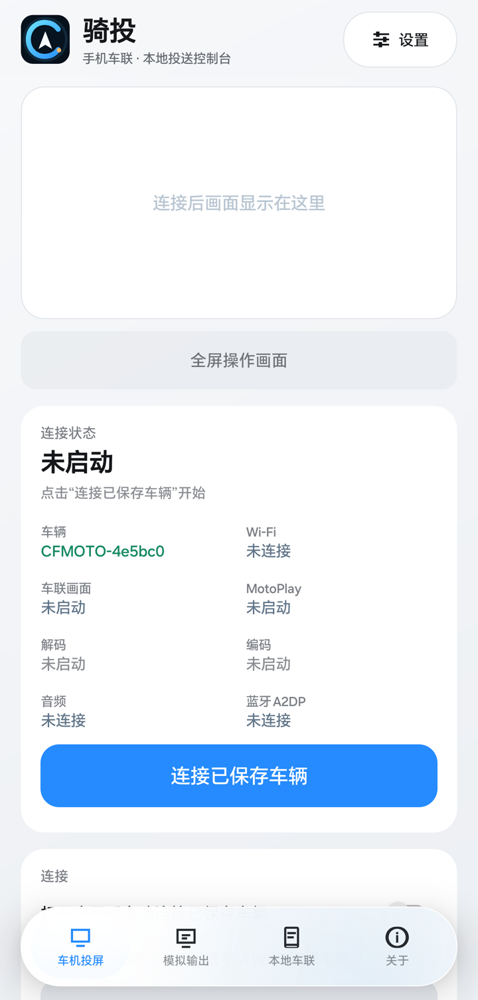
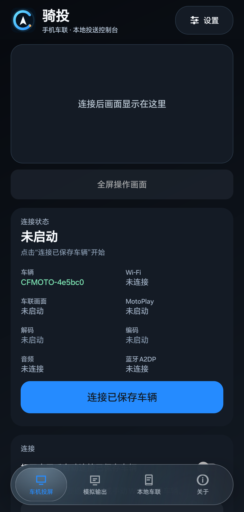
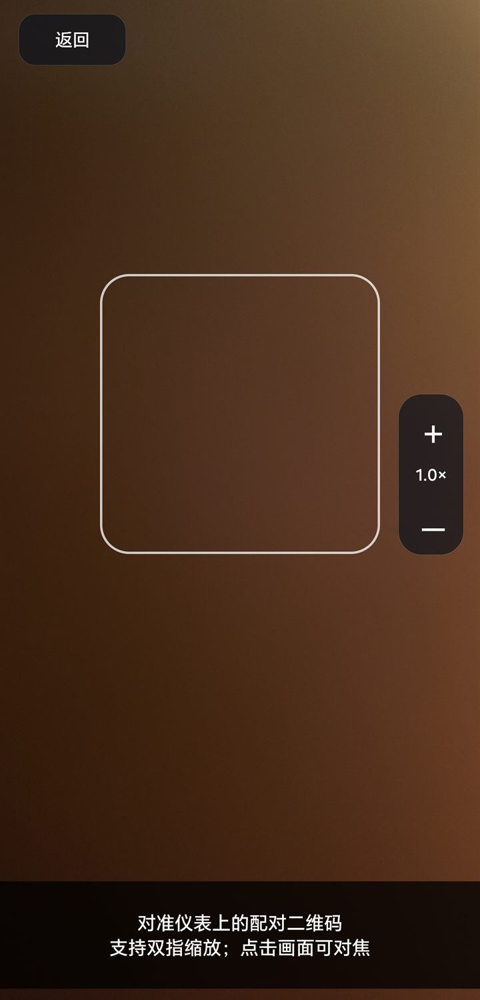
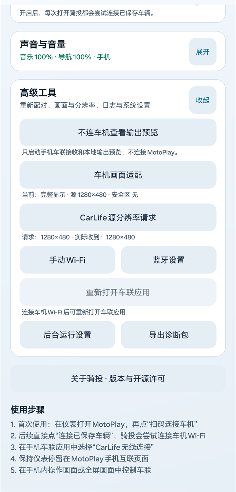

  

<h1 align="center">骑投 QITOU</h1>

  Android 手机车联 → 车机仪表本地桥接工具

  <a href="https://github.com/yuppiesnotzhuhao/QITOU/releases/latest">下载最新版</a>
  ·
  <a href="https://github.com/yuppiesnotzhuhao/QITOU/issues">问题反馈</a>

骑投（QITOU）把手机车联应用通过本机 CarLife 暴露的画面和声音，转接到兼容的车机
投送服务（当前已验证 MotoPlay / PXC 路线）。适合没有触摸屏、车把控制不完整，
但希望使用手机导航和媒体应用的摩托车用户。

项目不依赖 Android Auto、Google 地图、CarPlay、Shizuku、Root、无障碍服务或
悬浮窗。当前版本：`0.18.0 (64)`。

## 实机验证范围

| 手机 | 系统 | 车联应用 | 验证结果 |
| --- | --- | --- | --- |
| OPPO Find X8 Ultra | ColorOS 17 / Android 17 | OPPO Car+ | 手机车联输入、应用内触控、声音、MotoPlay/PXC 输出完整链路已验证 |
| 荣耀 Magic8 Pro Air（LDY-AN00） | MagicOS 11 / Android 17 | 荣耀车联 + CarLife+ 增强版 8.8.5 | 荣耀车联入口、CarLife loopback、真实车联桌面、应用内触控和投送连接已验证 |
| 仪表 | — | CFMOTO 450MT MotoPlay | OPPO 路线已完成实车验证 |

其他手机、其他车联版本、其他车型和仪表固件尚未完成完整适配。不同厂商
可能修改 CarLife 端口、车联界面、后台限制和蓝牙行为，因此不能仅凭 Android 版本
判断一定兼容。

> **荣耀手机重要前置条件：必须先连接蓝牙，再进入荣耀车联的“无线 WLAN 连接”并
> 点击“开始连接”。** 未连接蓝牙时，荣耀车联可能连接失败或一直停留在启动页。
>
> 这里指系统蓝牙链路必须已连接，推荐直接连接车机蓝牙；即使骑投的声音
> 输出选择“手机”，荣耀车联建立连接时仍可能需要蓝牙已连接。这里不是说声音必须
> 从车机蓝牙播放。

欢迎通过 [GitHub Issues](https://github.com/yuppiesnotzhuhao/QITOU/issues) 提交
其他机型和车机的测试结果。建议附上：

- “高级工具 → 导出诊断包”生成的 ZIP
- 手机型号、Android 版本和厂商系统版本
- 摩托车车型、仪表型号和车机投送固件版本
- 问题发生时的录屏、照片和操作步骤

诊断包会自动脱敏 Wi-Fi 密码和配对信息；公开分享前仍建议打开 ZIP 检查内容。

## 界面预览

| 浅色主页 | 深色主页 |
| :---: | :---: |
|  |  |

| 声音与音量 | 二维码扫描 |
| :---: | :---: |
|  |  |

| 高级工具 | 关于与开源许可 |
| :---: | :---: |
|  |  |

## 系统要求

- Android 10 及以上。
- OPPO / ColorOS：安装并启用支持本地 CarLife 输出的 OPPO Car+。
- 荣耀 / MagicOS：安装荣耀车联和 CarLife+ 增强版；使用前先连接蓝牙。
- 车机仪表支持与本项目兼容的本地投送协议。
- 使用车机蓝牙声音时，需要提前在系统蓝牙中完成车机配对。

最低系统版本只代表安装限制，不代表已经完成实机兼容验证。

## 首次使用

### 通用准备

1. 在摩托车仪表上打开手机互联 / 投送二维码页面。
2. 安装骑投并打开应用。
3. 按提示授予附近 Wi-Fi、通知和相机权限。
4. 蓝牙权限只在准备使用车机 A2DP 声音时申请。

### OPPO Car+

1. 点击骑投中的“扫码连接车机”。
2. 扫描仪表上的配对二维码，并允许系统连接车机热点。
3. 骑投会尝试打开 OPPO Car+。
4. 在 OPPO Car+ 中选择“CarLife 无线连接”，再点击连接。
5. 保持车机停留在手机互联 / 投送页面。
6. 回到骑投，在“手机车联操作画面”中触摸控制。

### 荣耀车联

> **必须先连接蓝牙。推荐先连接车机蓝牙，并保持蓝牙处于连接状态。**

1. 在系统蓝牙中连接车机，或按荣耀车联提示连接所需蓝牙设备。
2. 点击骑投中的“扫码连接车机”，完成仪表 Wi-Fi 配对。
3. 骑投会打开荣耀车联的“无线 WLAN 连接”页面。
4. 在荣耀车联页面点击“开始连接”，等待进入真实车联桌面。
5. 看到车联桌面后返回骑投。
6. 保持车机停留在手机互联 / 投送页面，在骑投中控制荣耀车联。

### 没有二维码或扫描失败

1. 确认仪表已经打开手机互联 / 投送页面。
2. 打开“高级工具 → 手动 Wi-Fi”。
3. 输入仪表显示的车机热点名称。
4. 开放网络可留空密码；需要密码时按仪表显示填写。
5. 点击“连接”，然后按对应品牌的车联步骤操作。

Android 不允许普通应用仅凭保存的 SSID 和密码静默切换 Wi-Fi。部分系统仍会显示
连接确认框，这是系统安全限制，骑投无法绕过。

### 已保存车辆的后续连接

- 已保存车辆后，主页按钮会变为“连接已保存车辆”。
- 打开“启动骑投时自动连接”后，下次启动应用会尝试连接已保存车辆。
- 自动连接只会尝试一次；发现热点不可用后会停止重试，避免反复弹出系统 Wi-Fi 页面。

## 功能使用方法

### 手机车联操作画面

车联画面直接显示在骑投主页中，可以直接触摸操作。

- 单指滑动、点击：操作手机车联界面。
- 支持多点触控，可用于地图缩放等操作。
- 画面尚未连接时，“全屏操作画面”按钮保持禁用。

### 全屏操作画面

点击“全屏操作画面”进入横屏全屏。左上角“退出全屏”返回主页，右上角显示当前接收
帧率。全屏模式仍然是在骑投应用内，不会创建悬浮窗。

### 不连车机查看输出预览

入口：“高级工具 → 不连车机查看输出预览”。

该功能只跳过车机投送服务和车机 Wi-Fi 连接，仍然需要手机车联应用提供本地
CarLife 画面。它用于检查：

- 最终准备发给车机的画面比例
- 左右黑边、上下黑边和裁切效果
- 自定义输出分辨率是否生效
- 安全区是否避开了仪表固定信息栏

本地预览显示的是重新合成后的车机画布，不是手机车联原始画面。

### 车机画面适配

入口：“高级工具 → 车机画面适配”。

- **完整显示**：保持源画面比例，多余区域留黑边，不裁切内容。默认推荐。
- **铺满裁切**：填满输出画布，比例不同时裁掉部分边缘。
- **拉伸铺满**：拉伸到整个画布，可能改变画面比例。
- **自定义车机输出宽/高**：定义最终编码并发送给车机的画布尺寸，不是“CarLife
  源分辨率请求”。填写 `0` 表示跟随车机上报尺寸。
- **安全区**：单位为输出画布像素，分别填写上、下、左、右。

当仪表把速度、挡位、油量等信息叠加在视频上时，用安全区把内容限制在可显示区域。
自定义分辨率在重新连接后生效。

### 输出分辨率

输出分辨率默认跟随车机通过投送协议上报的真实画布。特殊仪表可以手动设置为
`240–1920 × 240–1080`，编码前会自动调整为偶数。

输出分辨率影响最终发给摩托车仪表的数据，不等同于手机车联源码流分辨率。

### CarLife 源分辨率请求

入口：“高级工具 → CarLife 源分辨率请求”。

可选预设：

- `848×480`
- `1024×480`
- `1280×480`（默认）
- `1280×720`
- `1920×720`
- `1920×1080`

该设置只向手机车联发送端请求源码流尺寸，不改变车机输出分辨率。部分车联应用会忽略
请求并使用自己的白名单尺寸；实际结果以收到的 SPS 和视频流为准。

### 声音与音量

入口：主页“声音与音量”折叠区。

- “音乐”和“导航”使用独立音量滑杆。
- 开启“导航播报时自动压低音乐”后，导航提示期间会自动降低音乐音量。
- “手机”跟随 Android 当前媒体输出，可能是有线耳机、蓝牙耳机或手机扬声器。
- “车机蓝牙”只使用已配对的车机 A2DP；未连接时不会静默回退到手机扬声器。

如果手机已经连接车机蓝牙，即使输出选择“手机”，系统仍可能根据当前媒体路由把声音
送到车机蓝牙。要强制从其他设备播放，需要在系统音频路由中切换或断开对应蓝牙。

### 后台运行与息屏投送

入口：“高级工具 → 后台运行设置”。

1. 优先允许 Android 系统电池优化。
2. 如果息屏后仍断连、卡顿或画面停更，再打开应用详情设置厂商后台行为。

应用会根据手机厂商显示对应路径，例如：

- ColorOS：应用信息 → 耗电管理 → 完全允许后台行为
- MagicOS：应用信息 → 电池 → 允许后台活动
- HyperOS：应用信息 → 省电策略 → 无限制
- One UI：应用信息 → 电池 → 不受限制
- OriginOS / iQOO：应用信息 → 电池 → 后台耗电管理

厂商后台设置是投送不稳定时的可选排障项，不是必选项。部分系统不开放状态读取，需要
手动进入应用详情页设置。

### 流体云

Android 16 及以上、ColorOS 16 及以上系统会尝试把骑投前台通知提升为实时活动，在
支持的 ColorOS 设备上以流体云胶囊或卡片显示连接、投送和重连状态。

流体云由系统控制。关闭应用实时通知或流体云后，普通前台通知仍然保留，不影响投送。
入口通常位于“设置 → 通知与控制中心 → 流体云”。

### 诊断日志

入口：“高级工具 → 导出诊断包”。

日志会记录：

- Wi-Fi 和车机投送协议连接状态
- CarLife 端口、视频尺寸和帧率
- 实际使用的硬件/软件编解码器
- H.264 分辨率、Level、码率与关键配置
- 车机画布、适配模式和安全区
- 未知投送协议命令及脱敏后的配置片段
- 最近一次 Java/Kotlin 崩溃记录

应用保留 3 个轮转日志，单个上限约 1.5 MB。导出的 ZIP 包含全部轮转日志、设备摘要
和崩溃记录，通常不会超过约 10 MB。

## 常见问题

### OPPO Car+ 打开后没有自动连接

确认 OPPO Car+ 正常安装并已至少配置一次。进入 Car+ 后手动选择“CarLife 无线连接”，
再点击连接。部分版本还需要先允许通知或附近设备权限。

### 荣耀车联一直停在启动页

先检查系统蓝牙是否已连接，推荐直接连接车机蓝牙。然后重新进入
“荣耀车联 → 无线 WLAN 连接”，点击“开始连接”。不要直接启动 CarLife+ 主界面来
替代荣耀车联连接页。

### 点击连接后反复跳到系统 Wi-Fi

确认仪表仍停留在手机互联 / 投送页面，并且在手机 Wi-Fi 列表中能看到车机热点。
骑投只会在用户主动连接或热点短暂掉线时发起系统 Wi-Fi 请求，取消、超时或找不到
热点后会停止自动重试。

### 有画面但没有声音

检查“声音与音量”的选择。使用“手机”时检查 Android 当前媒体输出；使用“车机蓝牙”
时确认车机 A2DP 已连接，并已授予附近设备/蓝牙权限。

### 地图为什么不是高德或百度

骑投不接入地图 SDK，也不改变手机车联展示的应用。实际地图和导航能力由 OPPO Car+、
荣耀车联及手机内已安装的地图应用决定。

### 手机息屏后画面不更新

先设置系统电池优化；仍然不稳定时，再按“后台运行设置”中的本机品牌路径允许后台
运行。部分厂商还会限制息屏网络、蓝牙或前台服务，需要同时解除相应限制。

## 已知限制

- 仪表操作只在手机画面中完成，不依赖摩托车触摸屏或车把按键。
- MotoPlay / PXC 属于互操作性实现，后续仪表固件可能改变协议。
- 荣耀必须先连接蓝牙，不同 MagicOS、荣耀车联和 CarLife+ 版本可能改变连接页面。
- 不同手机厂商可能限制后台网络、蓝牙 A2DP 或息屏前台服务。
- 流体云仅适用于支持 Android 实时活动的系统，样式由系统决定。
- 骑投无法绕过系统首次连接 Wi-Fi 或蓝牙时的确认界面。
- 日志会脱敏密码和配对信息，但公开前仍建议人工检查内容。
- 本项目与 OPPO、荣耀、HONOR、CFMOTO、Google 无隶属或官方合作关系。

## 开发与构建

构建环境、签名配置和输出路径见 [docs/BUILDING.md](docs/BUILDING.md)。

媒体链路、PXC、CarLife 端口和分辨率处理见
[docs/ARCHITECTURE.md](docs/ARCHITECTURE.md)。

## 致谢

感谢 [CarWithin 项目](https://github.com/xmz28/CarWithin)及作者
[xmz28](https://github.com/xmz28)。CarWithin 的 iOS + CarPlay/CarLife 互联方案
为骑投的产品设计和协议研究提供了启发。

骑投还包含或改编自 OpenCfMoto、CarPToCarL、CarVeX 等开源项目。完整声明见
`NOTICE` 和 `app/src/main/assets/licenses/`。

## 开源许可证

骑投以 GNU Affero General Public License v3.0 only（`AGPL-3.0-only`）开源。
完整协议见 [LICENSE](LICENSE)。

分发修改版时，必须保留版权和许可声明，并按照 AGPL 提供 Corresponding Source。
