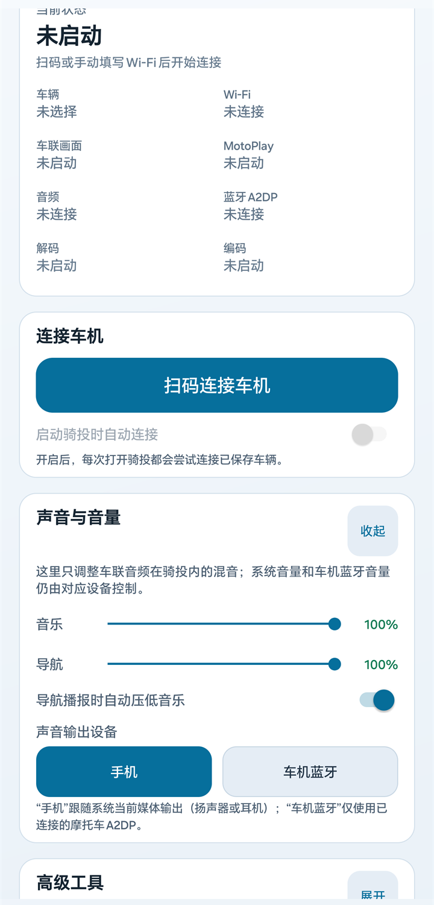
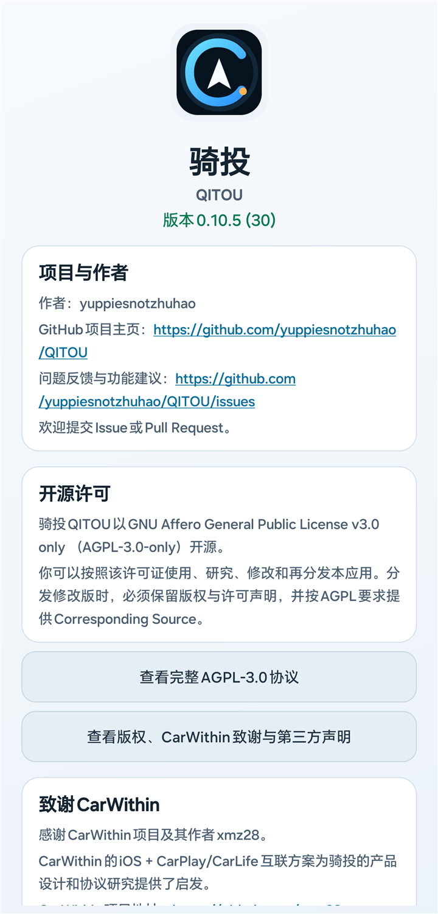

  

<h1 align="center">骑投 QITOU</h1>

骑投（QITOU）是一个 Android 手机端桥接工具，用于将 OPPO Car+ / CarLife
画面和声音投送到 CFMOTO 450MT 的 MotoPlay 仪表。

项目不依赖 Android Auto、Google 地图、CarPlay、Shizuku、Root、无障碍服务
或悬浮窗。

## 实机验证范围

当前版本仅在以下组合完成过实机测试：

- 手机：OPPO Find X8 Ultra
- 系统：ColorOS 17（Android 17）
- 仪表：CFMOTO 450MT MotoPlay

其他 OPPO 机型、其他 Android/ColorOS 版本以及其他 CFMOTO 车型或仪表固件尚未
完成实机验证，兼容性不作保证。MotoPlay、PXC、流体云和后台连接行为可能随手机
系统或仪表固件版本变化。

## 下载

请前往 [GitHub Releases](https://github.com/yuppiesnotzhuhao/QITOU/releases/latest)
下载最新 APK 和 SHA-256 校验文件。

## 系统要求

- Android 10 及以上
- 手机安装并登录 OPPO Car+
- 摩托车仪表支持 CFMOTO MotoPlay
- 使用车机蓝牙声音时，需要提前在系统蓝牙中配对车机

以上是代码支持的最低技术条件，不等同于已完成实机验证的兼容范围；实际验证范围
以上方“实机验证范围”为准。

## 流体云

Android 16 及以上、ColorOS 16 及以上系统会尝试将投送前台通知提升为系统实时活动，
在支持的 OPPO 设备上以流体云胶囊或卡片显示“连接中”“投送中”“重连中”等状态。

流体云由系统控制，应用不会额外创建第二个通知。Android 10～15、非 ColorOS 设备或
关闭了应用实时通知/流体云时，会继续显示普通前台通知，不影响投送功能。相关开关
通常位于“设置 → 通知与控制中心 → 流体云”。

## 界面预览

| 手机控制画面 | 深色模式 |
| :---: | :---: |
|  |  |

| 声音与连接 | 关于与项目信息 |
| :---: | :---: |
|  |  |

## 主要功能

- 将 OPPO Car+ 画面桥接到 CFMOTO MotoPlay。
- 支持二维码配对、手动 Wi-Fi 配对和断线自动重连。
- 可选在每次打开应用时自动连接上次保存的车机，默认关闭。
- Android 16+ / ColorOS 16+ 支持以标准 Live Updates 显示流体云投送状态。
- 主连接入口保持首屏可见，音频和高级工具采用折叠布局。
- 应用内提供手机控制画面、触控转发和横屏全屏模式。
- 连接日志按 3 个 1.5 MB 文件轮转，导出 ZIP 会包含全部日志和最近崩溃记录。
- 音乐与导航独立音量，导航播报时可自动压低音乐。
- 声音默认跟随手机；也可手动切换到车机蓝牙 A2DP。
- 支持息屏保活、前台通知和日志导出。
- 支持 Android 17 深色、浅色主题。

## 首次使用

1. 在摩托车仪表上打开 MotoPlay / 手机互联二维码页面。
2. 打开骑投，点击“扫码连接车机”。
3. 按系统提示授权附近设备、通知和相机权限。
4. 骑投连接仪表 Wi-Fi 后会自动打开 OPPO Car+。
5. 在 OPPO Car+ 中选择“CarLife 无线连接”并点击“连接”。
6. 保持仪表停留在 MotoPlay 页面。
7. 在手机上使用“手机控制画面”或“全屏控制”操作 Car+。

车机蓝牙权限只会在选择“车机蓝牙”时申请。拒绝蓝牙不会阻止投送，应用会继续
使用手机音频。

## 声音输出

- “手机”是默认选项，跟随 Android 当前媒体输出，可能使用扬声器、有线耳机
  或已连接的蓝牙耳机。
- “车机蓝牙”只使用已配对的 CFMOTO A2DP，未连接时不会静默回退。
- 音乐和导航音量在应用内分别调整。

## 常见问题

### 息屏后连接断开

打开骑投的“高级工具 → 后台运行设置”，先允许 Android 系统电池优化。若息屏后
仍然断连或画面停更，再点击“打开应用详情”，检查
“应用信息 → 耗电管理 → 完全允许后台行为”。

ColorOS 后台行为属于投屏不稳定时的可选排障项，不是必须修改的设置。ColorOS
不向普通应用开放这项状态，应用只能提供入口和手动路径。

### 点击连接后反复跳到系统 Wi-Fi

确认仪表仍停留在 MotoPlay 页面，并且手机 Wi-Fi 列表能看到
`CFMOTO-xxxxxx`。骑投只在用户点击连接或已连接热点短暂掉线时发起系统 Wi-Fi
请求；取消、超时或找不到热点后会停止自动重试，避免反复打开系统页面。

### 有画面但没有声音

确认当前的声音输出选择。使用手机音频时检查 Android 当前媒体输出设备；
使用车机蓝牙时确认 CFMOTO A2DP 已连接并授予附近设备权限。

### 为什么地图不是高德或百度

骑投只负责传递 OPPO Car+ 的画面和声音，不接入地图 SDK。实际地图和导航能力
由 OPPO Car+ 及手机中安装的地图应用提供。

### 日志会占用多少空间

应用保留 3 个轮转日志，每个上限约 1.5 MB，并保留最近一次 Java/Kotlin 崩溃记录。
导出的诊断 ZIP 包含全部轮转日志、设备摘要和崩溃记录。常规日志与导出缓存合计通常
不超过约 10 MB，不需要手动清理。

## 已知限制

- 仪表交互仅通过手机完成，不依赖摩托车触摸屏或车把按键。
- MotoPlay / PXC 为互操作性实现，后续仪表固件可能改变协议。
- 车机蓝牙和本地网络行为可能受 ColorOS 或手机厂商策略影响。
- 流体云仅在支持 Android 实时活动的系统上显示，具体样式由 ColorOS 决定。
- 骑投无法绕过 ColorOS 首次连接 Wi-Fi 时的系统确认界面。
- 日志会脱敏 Wi-Fi 密码和配对信息，但分享前仍建议检查内容。
- 本项目与 OPPO、CFMOTO、Google 无隶属或官方合作关系。

## 开发与构建

构建要求、Release 签名配置和输出路径见
[docs/BUILDING.md](docs/BUILDING.md)。

内部媒体链路、PXC 和端口说明见
[docs/ARCHITECTURE.md](docs/ARCHITECTURE.md)。

## 致谢

感谢 [CarWithin 项目](https://github.com/xmz28/CarWithin) 及作者
[xmz28](https://github.com/xmz28)。CarWithin 的 iOS + CarPlay/CarLife
互联方案为骑投的产品设计和协议研究提供了启发。

骑投还包含或改编了 OpenCfMoto、CarPToCarL、CarVeX 等开源项目。完整声明请查看
`NOTICE` 和 `app/src/main/assets/licenses/`。

## 开源许可证

骑投以 GNU Affero General Public License v3.0 only
（`AGPL-3.0-only`）开源。完整协议见 [LICENSE](LICENSE)。

分发修改版时，必须保留版权和许可声明，并按照 AGPL 提供 Corresponding Source。
